# Xyl's Xenotypes

Twelve xenotypes for RimWorld, from fungus-fed underground builders to engineered stone giants, aquatic sirens, and high-tech spacers. Each brings its own needs, strengths, and complications to colony life.

This mod includes the 12 xenotypes, 121 new genes, 4 factions, 4 scenarios, and a variety of new events, animals, buildings, and items.

<!-- TODO: Add a banner or in-game overview image and refine the opening pitch. -->

## Requirements

**RimWorld 1.7 and Biotech are required.**

Optional DLC unlocks additional content:

- **Royalty:** Innate psycast genes and The Siren scenario.
- **Ideology:** Xenotype preferences for memes and additional gene-based recipe and building unlocks.
- **Odyssey:** Additional space-related content, the zeegee pod crash, and selkie pack animals.

<!-- TODO: Confirm framework dependencies and load order for the published build. -->

## Xenotypes

<!-- TODO: Add a short gameplay paragraph beneath each card. Focus on the xenotype's overall colony role, distinctive choices, and meaningful tradeoffs rather than repeating the gene list. -->

### Bossaps

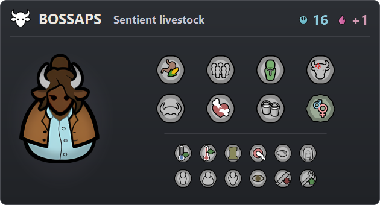

### Chyrr

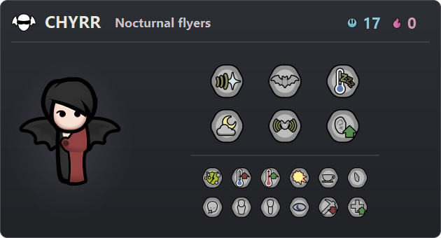

### Dvergr

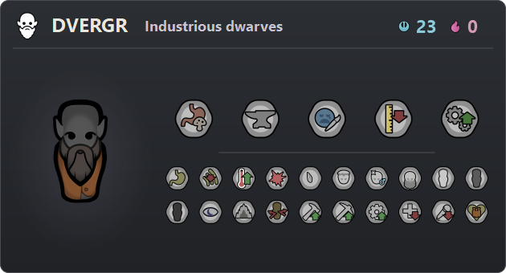

### Nixie

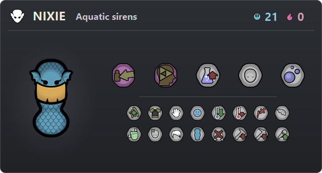

### Titan

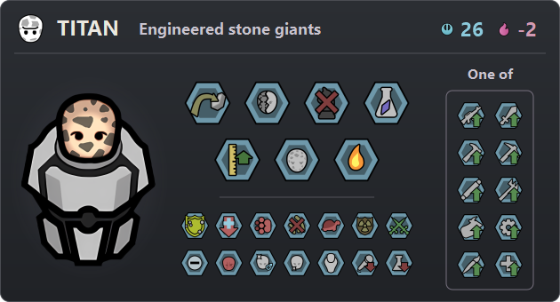

### Trog

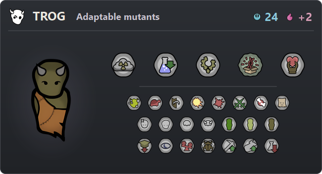

### Warcat

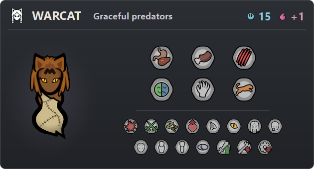

### Zeegee

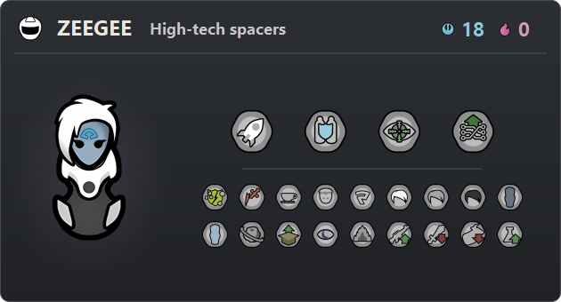

### Omegabeaver

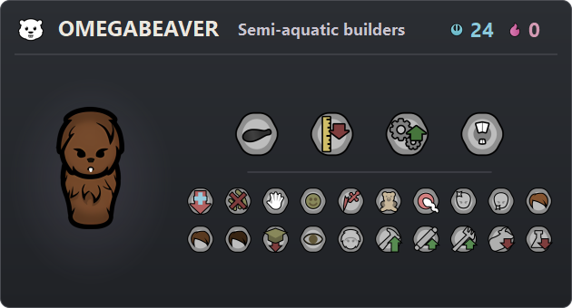

### Scaleborn

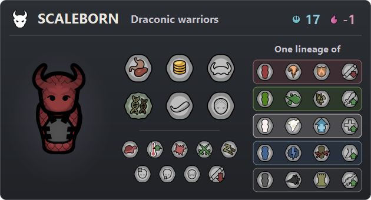

### Steadling

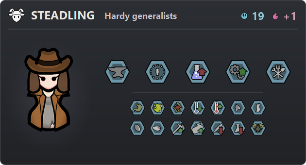

### Succuboid

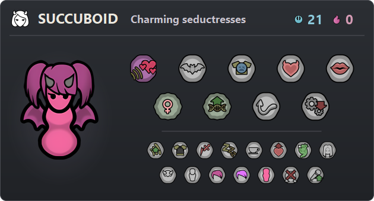

## Genes

<!-- TODO: Introduce the gene collection and highlight a few distinctive mechanics, cosmetic options, and Royalty psycasts. Add selected gene illustrations and point to the complete reference below. -->

## Other content

### Factions

<!-- TODO: Introduce the rough dvergr union, gentle nixie tribe, cannibal warcat tribe, and savage trog tribe. -->

### Scenarios

<!-- TODO: Summarize Dvergr Fortress, Menagerie, The Siren, and Warcat Tribe. Mark DLC requirements. -->

### Events and quests

<!-- TODO: Introduce A Titanic Problem, wild bossaps herds, and the zeegee pod crash. Explain how they bring the xenotypes into a colony's story. -->

### Items and buildings

<!-- TODO: Highlight lithoid drugs, coral, sea silk, and the nixie shower, with screenshots where useful. -->

### Animals

<!-- TODO: Introduce selkies and shellbacks, including where players encounter them. -->

### Ideology integration

<!-- TODO: Explain xenotype preferences for memes and gene-based recipe/building unlocks. -->

## Configuration

Individual xenotypes, including base-game xenotypes, can be enabled or disabled in the mod settings. Changes require a restart and do not alter characters or factions already present in a save.

<!-- TODO: Add a settings screenshot and any other player-facing options. -->

## Compatibility and known issues

<!-- TODO: List tested integrations, load-order guidance, known conflicts, and current limitations. Distinguish supported integrations from combinations that merely have not shown problems. -->

## FAQ

### Can I add this to an existing save?

<!-- TODO: Verify and describe mid-save installation, including which factions, events, or other content require a new world. -->

### Can I remove it from an existing save?

<!-- TODO: Document removal separately from installation, based on tested behavior. -->

### How do I find the xenotypes and acquire their genes?

<!-- TODO: Cover starting colonists, factions, events, traders, gene packs, and extraction where applicable. -->

### Can I use these genes in custom xenotypes?

<!-- TODO: Explain gene availability, special restrictions, and any dependencies between genes. -->

### Which genes are inherited?

<!-- TODO: Explain endogenes versus xenogenes, Scaleborn lineage inheritance, and other special inheritance rules. -->

## Documentation and support

- [Full xenotype and gene reference](../../README.md)
- [Content overview](../../CONTENT.md)

<!-- TODO: Add the final source-code, release-history, and bug-report links. Include what to provide with a bug report: game/mod versions, mod list, logs, reproduction steps, and a save when relevant. -->

## Credits and license

Created by **Xylthixlm**.

<!-- TODO: Credit contributors, third-party assets, and translations. Add any asset-specific permissions alongside the repository license. -->

[MIT license](../../../LICENSE)
